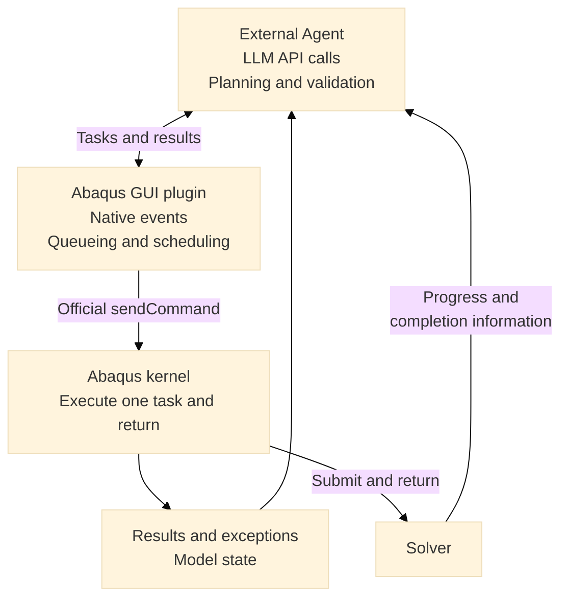

# Abaqus AI Agent

<p align="center">
  <a href="README.md"><b>English</b></a> |
  <a href="README_zh.md"><b>简体中文</b></a>
</p>

An LLM API driven engineering assistant for Abaqus/CAE. The external Agent plans, executes tools and verifies model state through a GUI event bridge, with durable task results and snapshot comparisons.

## Quick Start

1. Install the external client dependencies:

   ```powershell
   pip install -r requirements.txt
   Copy-Item .env.example .env
   ```

2. Configure your LLM endpoint and Abaqus command in `.env`:

   ```ini
   OPENAI_API_KEY=your_api_key_here
   OPENAI_BASE_URL=https://api.openai.com/v1
   MODEL_NAME=your_model_name
   ABAQUS_COMMAND=abaqus
   WORKSPACE_DIR=./workspace
   ABAQUS_BRIDGE_PORT=23457
   ABAQUS_TIMEOUT=300
   CONFIRM_BEFORE_EXEC=false
   AUTO_LAUNCH_ABAQUS=true
   ```

   Use an external Python 3.9+ environment. The GUI/plugin/kernel files use Python 2.7/3.x compatible syntax; actual toolkit behavior must be checked on the installed Abaqus release. `ABAQUS_IPC_DIR` optionally overrides the IPC directory. Its resolved path is passed to both Abaqus processes when launched by the client.

3. From the repository directory, start the client:

   ```powershell
   python run.py
   ```

   When auto-launch is enabled, the client writes a managed plugin-path block into the workspace `abaqus_v6.env`, preserving other settings, then launches Abaqus with the GUI plugin. The plugin starts its scheduler automatically. Enter a modeling request; subsequent tool calls execute automatically without clicking a menu or confirming each step.

   To launch CAE separately with the same configuration:

   ```powershell
   python run.py --launch-only
   ```

   The batch and PowerShell launchers in `abaqus_agent/bridge_server/` use this command too.

**Existing CAE sessions:** running `mount_bridge.py` through File → Run Script only loads the kernel executor. It cannot install callbacks in the separate GUI process. Save your work and reopen CAE through the configured launcher to load the plugin. The client never force-terminates an existing CAE session. Use a different workspace, IPC directory, and port for a separate session.

## Interaction Architecture



The external Agent owns the reasoning loop. GUI and kernel are separate Abaqus processes. The GUI plugin prefers the official `FXApp.addSocket()` interface for local task notifications, and calls `sendCommand()` from the GUI thread. If native socket registration is unavailable, it falls back to a one-shot `addTimeout()` callback, re-armed every 500 ms. The kernel has no waiting loop, background model-access thread, or manually pumped Windows message loop. Automatic dispatch does not simulate menu keys.

Tasks and results remain in `workspace/.ipc` (or `ABAQUS_IPC_DIR`). The socket carries only small `ping`/`wake` messages; scripts are published atomically as task files. GUI callbacks use nonblocking sockets with bounded buffers, handle partial incoming messages, and defer kernel execution to the scheduler. The scheduler runs one task per tick, guarding against reentrant dispatch.

**Execution and feedback:**

- Every task has a unique ID, a GUI session ID, and an expiration time. Atomic claim/cancellation distinguishes `queued`, `running`, `succeeded`, `failed`, and `cancelled`.
- The kernel captures stdout, stderr, traceback, and model summaries before/after execution. Results are preserved rather than discarded after the client reads them. A successful script does not establish engineering correctness; verify the requested model properties.
- Waiting timeout is not solver or script failure. An unclaimed task can be cancelled; a claimed task without a completion record is `OUTCOME_UNKNOWN`. The Agent stops dependent calls instead of automatically replaying the task. Inspect `/task <id>` without sending another kernel command. An unresolved running record blocks new work and is never automatically replayed after restart.
- Public GUI checks defer dispatch during detected GUI locks, visible Abaqus dialogs/popups, mouse interaction, and sketch editing. `AFXMainWindow.isEnabled()` is a widget input flag and is not used to determine kernel readiness. A guard error also defers execution. This is conservative detection, not a guarantee covering every third-party/custom modal workflow; use Stop Bridge before unsupported manual editing.
- `/ping` and the startup banner distinguish connectivity from `Idle`, `Blocked`, and `Executing`. A blocked wait timeout includes `BRIDGE_BLOCKED` and the GUI reason; the Agent stops that turn instead of repeatedly submitting alternative scripts. Inspect `workspace/.ipc/status.json` for the current reason. Expired tasks and tasks from older sessions are cancelled without entering the kernel.
- Mouse checks mask only the FOX left, middle, and right button bits; NumLock, CapsLock, and keyboard modifiers do not block dispatch. The status file includes `bridge_version` to identify the loaded GUI plugin, `gui.cursor_state` for the raw input state, and `gui.pressed_mouse_buttons` for the filtered mouse state.
- The scheduler returns control between tasks. A single expensive geometry/mesh command can still make CAE busy. A client timeout cannot safely interrupt such a command.
- Solver jobs should be submitted with `submit()` and returned immediately. Monitor job status or solver files in subsequent steps; do not use `waitForCompletion()` in interactive tasks. The solver branch in the diagram represents this workflow, not a separate always-on solver event subscription.

The socket mode still uses a short GUI timer for heartbeat, deferred scheduling, and connection cleanup. It is not a zero-overhead or guaranteed-FPS design. The timer fallback also scans the task directory. Both preserve the distinction between waiting in GUI events and occupying the kernel with a loop.

Official references: [GUI/kernel architecture](https://docs.software.vt.edu/abaqusv2025/English/SIMACAECUSRefMap/simacus-c-comcommandskernelandgui.htm), [FXApp socket/timer interfaces](https://docs.software.vt.edu/abaqusv2025/English/SIMACAEGUIRefHtml/pt01ch01gob66.htm), [sendCommand](https://docs.software.vt.edu/abaqusv2025/English/SIMACAECUSRefMap/simacus-c-comcommandsexecute.htm).

## Abaqus 2025 Knowledge Base

The active reference is `abaqus_agent/docs/abaqus2025_knowledge.json`: 25 English cards covering common kernel workflows, each with official 2025 source links, examples, caveats, and evidence labels. Chinese terms are retained as search aliases. This is a curated reference, not a complete API whitelist. The old unversioned Markdown reference is retained as legacy material and is no longer injected into Agent prompts.

The Agent retrieves relevant cards before planning and adds repair guidance after API errors. An AST precheck runs before task publication, including `/run`, and rejects known ownership mistakes such as `session.processUpdates()` and `mdb.openMdb()`, GUI-process imports, and proven blocking job waits. `API_PRECHECK` means that task did not execute; unknown APIs are allowed and can still fail at runtime. Runtime failures can leave partial model changes and require inspection before repair.

Use `/search session.processUpdates`, `/search ModelFromInputFile`, or `/search SectionAssignment` to inspect ownership, examples, cautions, and source links. Reloading this external knowledge/search code requires restarting the Agent; the GUI plugin does not need a restart for this change.

## Commands

| Command | Purpose |
| --- | --- |
| `/launch [dir]` | Launch a GUI session with the configured plugin |
| `/ping` | Probe the GUI transport; does not prove the kernel is idle |
| `/task <id>` | Read durable task state, output, traceback and model summaries |
| `/workspace`, `/pwd` | Inspect current Abaqus directory and model/result files |
| `/log [n]` | Read the replay log; it is evidence, not an authoritative model snapshot |
| `/status` | Query model entity counts |
| `/run <python>` | Execute one Python task without an LLM |
| `/search <query>` | Search bundled Abaqus API documentation |
| `/snapshot [tag]` | Save a model snapshot |
| `/diff [a] [b]` | Compare snapshots |
| `/reset` | Clear conversation context |
| `/help`, `/exit` | Help or exit |

GUI controls: `Plug-ins → Abaqus AI → Start Bridge / Stop Bridge`. `Run Single Task` remains a manual fallback; it runs at most one queued task. Stopping the scheduler does not interrupt an already executing kernel command. `CONFIRM_BEFORE_EXEC=true` enables optional terminal confirmation **before** a task is published.

## Verification

Run the mock integration tests without starting Abaqus, calling an LLM, or submitting a solver job:

```powershell
python -m unittest discover -s tests -v
```

To explicitly test a real CAE session, install the optional probe dependency with `pip install psutil`, then run the native probe below. It launches an isolated GUI, creates a disposable model, queries state, and closes the test session. Supply your own INP file for the optional import test; local model files are not included in this repository. The test imports into that session, deletes its default model, and displays the assembly. It does not call an LLM or submit an analysis; evidence is saved under `tests/native_runs/<id>/report.json`.

```powershell
python tests/native_bridge_probe.py
python tests/native_bridge_probe.py --import-inp path/to/model.inp
```

Before relying on automatic operation in your installed CAE release, check `/ping`, `/run print('bridge probe')`, and `/status`; then open an edit dialog and verify a queued task waits until the dialog closes. Test failures must be diagnosed from the task records and plugin messages. Local mocks do not prove real CAE GUI behavior.

## Publishing and Credentials

Keep provider credentials in the local `.env` file. Only `.env.example`, containing placeholders, belongs in Git. The ignore rules exclude environment-file variants, local workspaces, IPC requests/results, model snapshots, native diagnostic runs, editor settings, and Abaqus outputs; they do not delete those local files. Git does not automatically untrack a previously committed file when ignore rules change.

After staging a change and before committing, run:

```powershell
python scripts/check_release.py --staged
```

The checker reads the actual Git index blobs, checks for configured local secret values and common credential patterns, and rejects credential files or local runtime data. It prints file names and reasons rather than secret values. After committing, run `python scripts/check_release.py` to check the committed tree. These targeted checks are not exhaustive and do not scan older commit history; if a credential was published previously, revoke it with the provider and remove it from the repository history before publishing again.

## Project Structure

```text
run.py                              # CLI and configured launcher
abaqus_plugins/abaqus_ai/            # GUI event scheduler and manual menu entry
abaqus_agent/agent/                  # LLM tool-call loop
abaqus_agent/bridge/client.py        # Durable task publication and reconciliation
abaqus_agent/bridge_server/          # One-task kernel executor and shared protocol
abaqus_agent/tools/                  # Tool registry and model inspection
abaqus_agent/docs/                   # Bundled Abaqus API reference
workspace/.ipc/                     # Session status, queue and durable results
tests/                              # Mock bridge and Agent integration tests
scripts/check_release.py            # Redacted pre-publication checks of Git blobs
```

## References and License

[Cai-aa/abaqus-mcp](https://github.com/Cai-aa/abaqus-mcp) informed the file relay design. Its cooperative/background modes have their own execution constraints. [jianzhichun/abaqus-mcp-server](https://github.com/jianzhichun/abaqus-mcp-server) demonstrates Windows GUI automation; this implementation replaces simulated menu dispatch with GUI toolkit events.

[MIT License](LICENSE).
