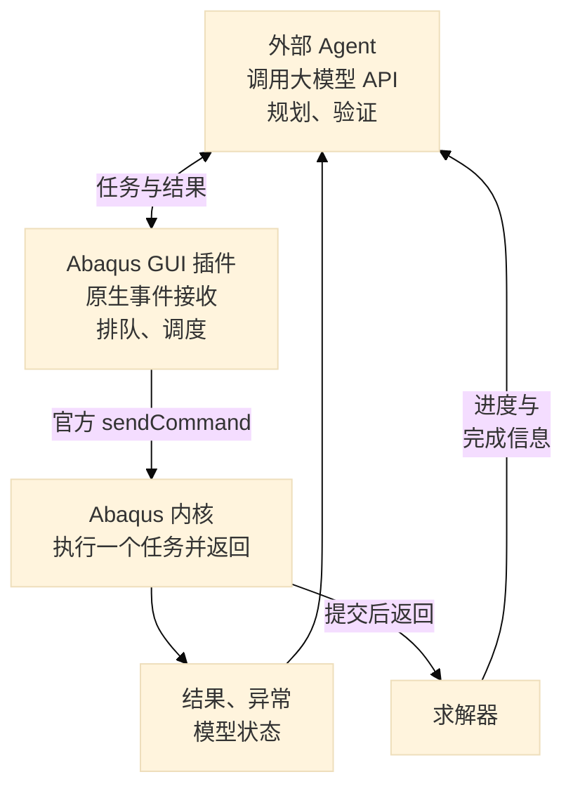

# Abaqus AI 智能体

<p align="center">
  <a href="README.md"><b>English</b></a> |
  <a href="README_zh.md"><b>简体中文</b></a>
</p>

通过大模型 API 驱动 Abaqus/CAE 的工程助手。外部 Agent 负责规划、工具调用和结果验证，GUI 事件桥接负责自动调度，内核执行有限任务后立即返回，并保留任务结果和模型快照。

## 快速开始

1. 在外部 Python 环境安装依赖并创建配置：

   ```powershell
   pip install -r requirements.txt
   Copy-Item .env.example .env
   ```

2. 在 `.env` 中配置大模型接口和 Abaqus 命令：

   ```ini
   OPENAI_API_KEY=your_api_key_here
   OPENAI_BASE_URL=https://api.openai.com/v1
   MODEL_NAME=your_model_name
   ABAQUS_COMMAND=abaqus
   WORKSPACE_DIR=./workspace
   ABAQUS_BRIDGE_PORT=23457
   ABAQUS_TIMEOUT=300
   CONFIRM_BEFORE_EXEC=false
   AUTO_LAUNCH_ABAQUS=true
   ```

   外部客户端需要 Python 3.9+。GUI 插件、内核执行器和共享协议采用兼容 Python 2.7/3.x 的语法；实际 GUI Toolkit 行为仍需在安装的 Abaqus 版本上验证。不要依据年份猜测内置 Python 版本。可用 `ABAQUS_IPC_DIR` 自定义通信目录，客户端启动 Abaqus 时会把解析后的路径传递给两个进程。

3. 在项目根目录运行：

   ```powershell
   python run.py
   ```

   启用自动启动时，客户端会在工作目录的 `abaqus_v6.env` 中写入受管理的插件路径配置，保留其他设置，再启动 Abaqus。GUI 插件加载后自动注册调度器。输入建模需求后，后续工具调用自动执行，无需逐步点击菜单或确认。

   也可以先单独启动配置好的 CAE，再运行交互终端：

   ```powershell
   python run.py --launch-only
   ```

   `abaqus_agent/bridge_server/` 下的批处理和 PowerShell 启动脚本也使用这条入口。

**已有 CAE 窗口：**通过 `File → Run Script` 执行 `mount_bridge.py` 只会加载内核执行器，无法向另一个 GUI 进程安装事件回调。保存当前工作后，用配置好的启动入口重新打开 CAE，让插件在启动阶段加载。客户端不会强制结束已有 CAE 进程。不同会话应使用不同工作目录、IPC 目录和端口。

## 交互架构



外部 Agent 维持推理与工具调用闭环。Abaqus GUI 和内核是两个独立进程：GUI 插件优先通过官方 `FXApp.addSocket()` 接收本地任务通知，并在 GUI 线程调用 `sendCommand()`。原生 socket 注册不可用时，退回一次性的 `addTimeout()` 回调，每 500 毫秒重新注册。内核中不运行等待循环、不启动访问模型对象的后台线程，也不手动泵送 Windows 消息。自动调度不模拟菜单按键。

任务与结果保存在 `workspace/.ipc`，或指定的 `ABAQUS_IPC_DIR`。socket 只传递少量 `ping`/`wake` 控制消息，脚本通过原子写入的任务文件发布。GUI 回调使用非阻塞 socket、限制缓存大小、处理分段消息，并将内核执行交给调度器。每次定时回调最多调度一个任务，执行期间防止回调重入产生第二次模型修改。

**任务执行与反馈：**

- 每个任务有唯一 ID、GUI 会话 ID 和过期时间。通过原子认领与取消区分 `queued`、`running`、`succeeded`、`failed`、`cancelled` 状态。
- 内核记录标准输出、错误输出、异常堆栈及执行前后的模型摘要。客户端读取后仍保留结果。脚本执行成功不代表工程目标正确，应继续检查目标模型属性。
- 等待超时不等于脚本或求解器失败。尚未认领的任务可以取消；已认领但没有完成记录时返回 `OUTCOME_UNKNOWN`，Agent 停止后续依赖调用，避免自动重放。可用 `/task <id>` 查询磁盘证据，无需再次调用内核。未解决的运行记录会阻止新任务，重启后也不会自动重放。
- 公共 GUI 检查会在检测到 GUI 锁定、可见 Abaqus 对话框或弹出菜单、鼠标操作和草图编辑时暂缓执行。`AFXMainWindow.isEnabled()` 只表示控件输入标志，不用于判断内核是否就绪；检查接口异常时也暂缓。这属于保守检测，不能保证覆盖所有第三方插件或自定义模态交互；进行未覆盖的人工编辑前使用 Stop Bridge。
- `/ping` 和启动横幅会区分连接状态与 `Idle`、`Blocked`、`Executing`。因 GUI 阻塞而等待超时时，错误包含 `BRIDGE_BLOCKED` 和具体原因，Agent 会结束本轮，避免反复提交其他脚本。可查看 `workspace/.ipc/status.json` 了解当前阻塞原因。过期任务和旧会话任务直接取消，不进入内核。
- 鼠标检查只检查 FOX 的左、中、右键掩码，NumLock、CapsLock 和键盘修饰键不会被误判为鼠标操作。状态文件中的 `bridge_version` 用于确认 GUI 已加载新版插件；`gui.cursor_state` 记录原始输入状态，`gui.pressed_mouse_buttons` 记录筛选后的鼠标按键。
- 调度器在任务间隙交还控制权。单次复杂几何或网格操作仍可能让 CAE 忙碌，客户端超时不能安全中断该操作。
- 求解作业应通过 `submit()` 提交后立即返回，再分步查询作业状态或求解器文件；交互任务中不要调用 `waitForCompletion()`。图中的求解器分支表达这一流程，当前没有独立的常驻求解器事件订阅器。

socket 模式仍有短 GUI 定时回调，用于心跳、延迟调度和连接清理；定时器回退模式还会扫描任务目录。两者都不是零开销方案，也不承诺固定帧率。关键是等待发生在 GUI 事件之间，而不是长期占住内核执行入口。

官方文档：[GUI 与内核架构](https://docs.software.vt.edu/abaqusv2025/English/SIMACAECUSRefMap/simacus-c-comcommandskernelandgui.htm)、[FXApp socket 与定时器接口](https://docs.software.vt.edu/abaqusv2025/English/SIMACAEGUIRefHtml/pt01ch01gob66.htm)、[sendCommand](https://docs.software.vt.edu/abaqusv2025/English/SIMACAECUSRefMap/simacus-c-comcommandsexecute.htm)。

## Abaqus 2025 知识库

当前参考源为 `abaqus_agent/docs/abaqus2025_knowledge.json`：25 张英文知识卡片，覆盖常用内核工作流，包含官方 2025 来源、示例、注意事项与验证等级。中文词汇只作为检索别名。这是精选参考库，不是完整 API 白名单；旧版未标注版本的 Markdown 参考保留为历史材料，不再注入 Agent 提示词。

Agent 在规划前自动检索参考，在 API 报错后补充修复用法。AST 检查在发布任务前运行，覆盖 `/run`，会拦截已知归属错误（如 `session.processUpdates()`、`mdb.openMdb()`）、GUI 进程模块导入及可识别的阻塞作业等待。`API_PRECHECK` 表示本次任务尚未执行；未收录的 API 不会被直接判为无效，仍可能在运行时报错。运行时失败可能已留下部分修改，需要检查后再修复。

可用 `/search session.processUpdates`、`/search ModelFromInputFile` 或 `/search SectionAssignment` 查看正确归属、示例与来源。本次知识库和检索代码位于外部 Agent，重启 Agent 即可生效，无需因此重启 GUI 插件。

## 常用命令

| 命令 | 用途 |
| --- | --- |
| `/launch [dir]` | 使用配置好的 GUI 插件启动 CAE |
| `/ping` | 探测 GUI 通信入口，不代表内核当前空闲 |
| `/task <id>` | 查询持久任务状态、输出、异常和模型摘要 |
| `/workspace`、`/pwd` | 查看当前 Abaqus 目录及模型、结果文件 |
| `/log [n]` | 读取回放日志；日志是证据，不能代替真实模型快照 |
| `/status` | 查询模型实体统计 |
| `/run <python>` | 绕过大模型，执行一个 Python 任务 |
| `/search <query>` | 检索项目自带的 Abaqus API 文档 |
| `/snapshot [tag]` | 保存模型快照 |
| `/diff [a] [b]` | 比较模型快照 |
| `/reset` | 清空对话上下文 |
| `/help`、`/exit` | 帮助与退出 |

GUI 控制入口为 `Plug-ins → Abaqus AI → Start Bridge / Stop Bridge`。`Run Single Task` 保留为人工兜底，每次最多执行一个任务。停止调度器不会中断已开始的内核命令。设置 `CONFIRM_BEFORE_EXEC=true` 可启用可选的终端确认，确认发生在任务发布之前。

## 验证方式

运行模拟集成测试，不启动 Abaqus、不调用大模型，也不提交仿真：

```powershell
python -m unittest discover -s tests -v
```

在实际 CAE 版本中投入使用前，先检查 `/ping`、`/run print('bridge probe')` 和 `/status`，再打开编辑对话框，验证任务会等待对话框关闭后执行。发生问题时查看任务记录和插件启动消息。本地模拟测试不能证明真实 CAE GUI 行为。

也可明确运行真实 CAE 诊断：先通过 `pip install psutil` 安装诊断脚本的可选依赖，再运行以下命令。脚本自动启动独立会话、创建临时模型并查询状态。可选导入测试需要提供自己的 INP 文件，仓库不包含本地模型文件；导入后会删除测试会话的默认模型并显示装配。诊断不调用大模型、不提交仿真，记录保存在 `tests/native_runs/<id>/report.json`，结束时关闭测试会话。

```powershell
python tests/native_bridge_probe.py
python tests/native_bridge_probe.py --import-inp path/to/model.inp
```

## 发布与密钥管理

API 密钥只填写在本地 `.env` 中，Git 只收录使用占位符的 `.env.example`。忽略规则排除了环境配置及其备份、本地工作目录、IPC 任务与结果、模型快照、真实 CAE 诊断记录、编辑器配置和 Abaqus 输出，不会删除这些本地文件。已经被 Git 跟踪的文件不会因为新增忽略规则而自动退出跟踪。

暂存修改后、提交前运行：

```powershell
python scripts/check_release.py --staged
```

检查脚本读取实际暂存的 Git 文件内容，匹配本地配置中的密钥和常见凭据格式，并拦截凭据文件及运行数据。输出仅包含文件名和原因，不打印密钥。提交后可运行 `python scripts/check_release.py` 检查已提交的文件。这是针对性检查，不覆盖所有密钥格式，也不扫描旧提交历史；如果凭据以前已被发布，应先在服务商处撤销，再清理仓库历史后重新发布。

## 项目结构

```text
run.py                              # 交互终端与统一配置启动入口
abaqus_plugins/abaqus_ai/            # GUI 事件调度器与人工菜单入口
abaqus_agent/agent/                  # 大模型工具调用闭环
abaqus_agent/bridge/client.py        # 任务发布、等待及结果核对
abaqus_agent/bridge_server/          # 单任务内核执行器与共享协议
abaqus_agent/tools/                  # 工具注册与模型检查
abaqus_agent/docs/                   # Abaqus API 参考资料
workspace/.ipc/                     # 会话状态、任务队列与持久结果
tests/                              # 桥接与 Agent 模拟集成测试
scripts/check_release.py            # 检查 Git 文件内容，不打印密钥
```

## 参考项目与许可

[Cai-aa/abaqus-mcp](https://github.com/Cai-aa/abaqus-mcp) 为文件中继设计提供了参考，其协同循环与后台线程模式各有执行限制。[jianzhichun/abaqus-mcp-server](https://github.com/jianzhichun/abaqus-mcp-server) 展示了 Windows GUI 自动化；本项目采用 GUI Toolkit 原生事件替换模拟菜单触发。

[MIT 许可证](LICENSE)。
